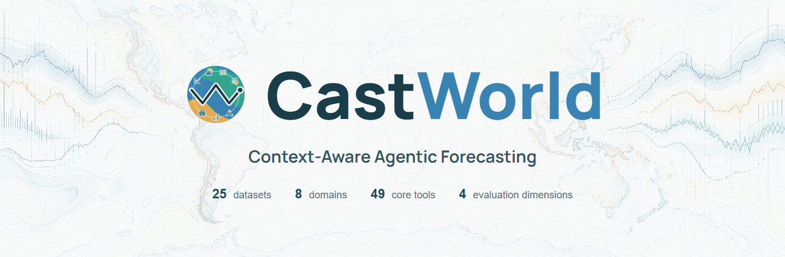
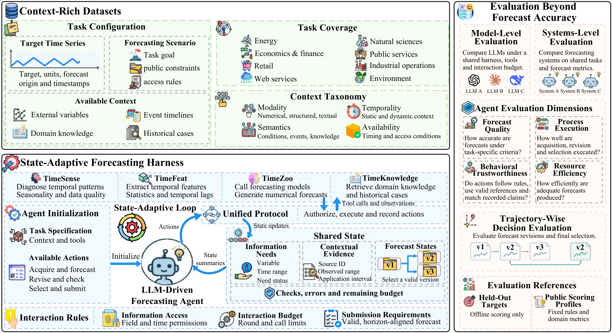

<h1 align="center">
  
</h1>

<p align="center"><strong>English</strong> · <a href="README.zh-CN.md"><kbd>简体中文</kbd></a></p>

<p align="center"><strong>Benchmarking Context-Aware Agentic Time Series Forecasting Beyond Predictive Accuracy</strong></p>

<p align="center">
  <a href="https://castworld-bench.github.io/"></a>
  <a href="https://arxiv.org/abs/2611.15262"></a>
  <a href="#leaderboards"></a>
  <a href="docs/GETTING_STARTED.md"></a>
</p>

CastWorld evaluates how LLM-driven agents acquire evidence, construct and revise numerical forecasts, and select final predictions in a shared context-aware environment. It combines a context-rich dataset suite, a lightweight, modular state-adaptive forecasting harness, and decision-centric evaluation.

**Model-level evaluation** is the primary focus: LLMs use the same forecasting harness and are evaluated on **forecast quality, process execution, behavioral trustworthiness, and resource efficiency**. **System-level evaluation** compares the predictive accuracy of forecasting systems on the same tasks.

<p align="center">
  <a href="docs/assets/overview.pdf"></a>
</p>

<a id="one-environment-three-connected-pieces"></a>
### One Environment, Three Connected Pieces 

- **Context-rich tasks.** Target histories, external variables, events, domain knowledge, and historical cases are organized under a unified context specification.
- **A state-adaptive harness.** Acquisition, forecast, and execution state support evidence gathering, numerical revision, public checks, and final selection without prescribing one solution workflow.
- **Decision-centric evaluation.** Assess forecast quality, process execution, behavioral trustworthiness, and resource efficiency, alongside system-level comparisons of predictive accuracy.

[Project homepage](https://castworld-bench.github.io/) · [Leaderboards](#leaderboards) · [Quick start](#quick-start) · [Dataset guide](docs/DATASETS.md) · [Evaluation guide](docs/EXPERIMENTS.md)

<a id="leaderboards"></a>
## Leaderboards 

The paper reports results on a suite of 1,310 forecasting tasks and compares 15 LLMs on a common subset of 250. The A and B leaderboards use separately defined task sets. Both publish the inputs available at forecast time. A also publishes the target values for the forecast horizon; for B, only the organizers hold those values for scoring.

| Cohort | Model | System | Ground truth |
| --- | --- | --- | --- |
| **A / Public - 300 episodes** | [15 models; pending](#a-model) | [24 methods; pending](#a-system) | Public |
| **B / Hidden - 100 episodes** | [15 models; pending](#b-model) | [24 methods; pending](#b-system) | Organizer-held |

**CastWorld-A contains 300 episodes; CastWorld-B contains 100 episodes across the 25-dataset suite.** Select a cohort first, then Model or System on the [project homepage](https://castworld-bench.github.io/#leaderboards). All four boards await independent evaluation. A dash denotes a pending result, not a zero score. CSV exports preserve empty pending cells. The homepage supports English and Chinese with a persistent header switch.

<a id="a-model"></a>
<details>
<summary><strong>A / Public (300 episodes) - Model</strong></summary>

Awaiting evaluation. Model-level evaluation compares 15 LLMs under the same harness across four score dimensions and TotalScore.

<!-- BEGIN A_MODEL_TABLE -->
| Rank | Model | Total | Forecast | Process | Trust | Efficiency |
| --- | --- | --- | --- | --- | --- | --- |
| - | GPT-6 Astra | - | - | - | - | - |
| - | GPT-6.1 Sol | - | - | - | - | - |
| - | DeepSeek-V4-Flash | - | - | - | - | - |
| - | Kimi K2.6 | - | - | - | - | - |
| - | Gemini 3.8 Flash | - | - | - | - | - |
| - | Grok4.7 | - | - | - | - | - |
| - | Claude Opus 5.5 | - | - | - | - | - |
| - | Qwen3.8-flash | - | - | - | - | - |
| - | GLM-5.3-flash | - | - | - | - | - |
| - | Claude Sonnet 5.5 | - | - | - | - | - |
| - | Qwen3.5-27B | - | - | - | - | - |
| - | GPT-6 Luna | - | - | - | - | - |
| - | Qwen3.5-4B | - | - | - | - | - |
| - | Qwen3.5-122B-A10B | - | - | - | - | - |
| - | Qwen3.5-9B | - | - | - | - | - |
<!-- END A_MODEL_TABLE -->

</details>

<a id="a-system"></a>
<details>
<summary><strong>A / Public (300 episodes) - System</strong></summary>

Awaiting evaluation. System-level evaluation compares 24 forecasting methods using MASE, RMSSE and average rank.

<!-- BEGIN A_SYSTEM_TABLE -->
| Method | MASE | RMSSE | Avg. rank |
| --- | --- | --- | --- |
| ARIMAX | - | - | - |
| DLinear | - | - | - |
| PatchTST | - | - | - |
| iTransformer | - | - | - |
| TimeXer | - | - | - |
| TimesFM | - | - | - |
| Moirai | - | - | - |
| Sundial | - | - | - |
| Chronos | - | - | - |
| PromptCast | - | - | - |
| Time-LLM | - | - | - |
| TokenCast | - | - | - |
| LLMTime | - | - | - |
| TimeReasoner | - | - | - |
| Time-R1 | - | - | - |
| MemCast | - | - | - |
| AlphaCast | - | - | - |
| TimeCopilot | - | - | - |
| TimeSeriesScientist | - | - | - |
| Cast-R1 | - | - | - |
| CastFlow | - | - | - |
| MoiraiAgent | - | - | - |
| CastFSR | - | - | - |
| CastWorld | - | - | - |
<!-- END A_SYSTEM_TABLE -->

</details>

<a id="b-model"></a>
<details>
<summary><strong>B / Hidden (100 episodes) - Model</strong></summary>

Awaiting evaluation. Model-level evaluation compares 15 LLMs under the same harness across four score dimensions and TotalScore.

<!-- BEGIN B_MODEL_TABLE -->
| Rank | Model | Total | Forecast | Process | Trust | Efficiency |
| --- | --- | --- | --- | --- | --- | --- |
| - | GPT-6 Astra | - | - | - | - | - |
| - | GPT-6.1 Sol | - | - | - | - | - |
| - | DeepSeek-V4-Flash | - | - | - | - | - |
| - | Kimi K2.6 | - | - | - | - | - |
| - | Gemini 3.8 Flash | - | - | - | - | - |
| - | Grok4.7 | - | - | - | - | - |
| - | Claude Opus 5.5 | - | - | - | - | - |
| - | Qwen3.8-flash | - | - | - | - | - |
| - | GLM-5.3-flash | - | - | - | - | - |
| - | Claude Sonnet 5.5 | - | - | - | - | - |
| - | Qwen3.5-27B | - | - | - | - | - |
| - | GPT-6 Luna | - | - | - | - | - |
| - | Qwen3.5-4B | - | - | - | - | - |
| - | Qwen3.5-122B-A10B | - | - | - | - | - |
| - | Qwen3.5-9B | - | - | - | - | - |
<!-- END B_MODEL_TABLE -->

</details>

<a id="b-system"></a>
<details>
<summary><strong>B / Hidden (100 episodes) - System</strong></summary>

Awaiting evaluation. System-level evaluation compares 24 forecasting methods using MASE, RMSSE and average rank.

<!-- BEGIN B_SYSTEM_TABLE -->
| Method | MASE | RMSSE | Avg. rank |
| --- | --- | --- | --- |
| ARIMAX | - | - | - |
| DLinear | - | - | - |
| PatchTST | - | - | - |
| iTransformer | - | - | - |
| TimeXer | - | - | - |
| TimesFM | - | - | - |
| Moirai | - | - | - |
| Sundial | - | - | - |
| Chronos | - | - | - |
| PromptCast | - | - | - |
| Time-LLM | - | - | - |
| TokenCast | - | - | - |
| LLMTime | - | - | - |
| TimeReasoner | - | - | - |
| Time-R1 | - | - | - |
| MemCast | - | - | - |
| AlphaCast | - | - | - |
| TimeCopilot | - | - | - |
| TimeSeriesScientist | - | - | - |
| Cast-R1 | - | - | - |
| CastFlow | - | - | - |
| MoiraiAgent | - | - | - |
| CastFSR | - | - | - |
| CastWorld | - | - | - |
<!-- END B_SYSTEM_TABLE -->

</details>

See the [board guide](docs/LEADERBOARDS.md) for their scope and the [Hugging Face setup guide](docs/HUGGINGFACE.md) for A/B hosting and submission operations.

A/B numerical data use GIFT-Eval-style Hugging Face dataset directories and a GluonTS-compatible loader. See [A/B data access](docs/AB_DATA.md); existing Agent task packs supply context, knowledge, and tools.

Within each leaderboard, Model and System use the same tasks: Model compares LLMs in a shared harness, while System compares end-to-end forecasting methods.

<a id="how-castworld-works"></a>
## How CastWorld works 

[View the overview as a PDF](docs/assets/overview.pdf).

The **dataset suite** pairs target histories and forecast specifications with external variables, event timelines, domain knowledge, and historical cases under explicit access permissions. The context specification describes modality, temporality, semantics, and availability as complementary attributes.

The **state-adaptive harness** lets evidence acquisition and forecasting inform each other: an intermediate forecast can motivate another query, and new evidence can guide a numerical revision. Shared acquisition, forecast, and execution state records what the agent has obtained, which versions it has created, execution feedback, and the remaining budget. Its 49 core tools support retrieval, analysis, forecast construction, and checking, alongside domain-specific diagnostic extensions. The paper groups these capabilities into four families: TimeSense (time-series diagnostics), TimeFeat (feature extraction), TimeZoo (forecasting models), and TimeKnowledge (domain knowledge and historical cases). See the [benchmark specification](docs/BENCHMARK.md#resources-and-operations) for the corresponding tool interfaces.

**Decision-centric evaluation** links the execution trajectory to immutable forecast versions, separating numerical revision from final selection. Held-out targets and frozen scoring profiles are used offline. Model-level evaluation compares LLMs under the same harness; system-level evaluation compares predictive accuracy across forecasting systems.

The eight application domains are energy, natural sciences, economics and finance, public services, retail, industrial operations, Web services, and environment. See the [dataset and field guide](docs/DATASETS.md) for all 25 datasets, field meanings, units, and released access permissions.

<a id="quick-start"></a>
## Quick start 

### 1. Install and prepare

Download and extract the repository ZIP, then enter the repository root. Use **Python 3.11 or 3.12**. Linux is recommended for fresh inference with native forecasting tools; the portable A/B runner also supports Windows.

```bash
python -m venv .venv
# Linux/macOS: source .venv/bin/activate
# Windows PowerShell: .venv\Scripts\Activate.ps1
python -m pip install -c requirements-reproduce.txt -e ".[test,data]"
python tools/reproduce.py prepare
python tools/reproduce.py audit --cohort A --no-cache
python tools/reproduce.py audit --cohort B --no-cache
```

`prepare` verifies and extracts the included archives without downloading data or calling an LLM. Allow about 3 GB for extraction, plus space for the environment and new logs. No Git LFS or previous server checkout is needed. The input audits above omit native-candidate checks. The expanded release currently includes 500 of 1,600 required Chronos, TimesFM, Sundial, and Moirai candidates. Complete evaluation therefore requires live local forecasting tools or the remaining matching cache entries. Cache-only generation checks all selected candidates before starting any LLM request.

**Looking for all 25 datasets?** The released source series and A/B task packages are included in [release/assets](release/assets), as `raw_<dataset>.zip` and `dataset_<dataset>.zip`. The [release map](release/README.md) identifies the data, harness, and evaluation files.

The published source tables are also directly available under [raw_data/csv](raw_data/csv) and [raw_data/json](raw_data/json), with one folder per dataset. JSON uses lossless positional tables with original cell text; see the [format and verification guide](raw_data/README.md). Both views match the released data scope and do not expose B ground truth.

### 2. Run an offline smoke test

```bash
python -m castbench.cli demo --out runs/offline_demo
python tools/test_release.py
```

The demo uses synthetic inputs and a scripted agent. It writes a trace and a legacy smoke score; it does not reproduce an A/B benchmark score. Both commands require no paid API calls or GPU weights.

### 3. Evaluate an LLM

Use an OpenAI-compatible **Chat Completions** endpoint that supports native function calling (the harness exposes `environment_action`) and reports token usage. To change the endpoint, model, capacity limits, or provider options, copy `examples/portable_deepseek.json` to a local profile and pass its path to `--provider`. Store the API key in the environment variable named by that profile.

The example uses live inference: configure the [four local forecasting models](docs/REPRODUCTION.md#native-tools), replace `/absolute/path/models.json` with your deployment profile, and describe your setup in `--deployment`.

```bash
export CASTWORLD_API_KEY='YOUR_KEY'
# PowerShell: $env:CASTWORLD_API_KEY='YOUR_KEY'
python tools/reproduce.py run --cohort A --provider examples/portable_deepseek.json --out runs/deepseek_A --deployment "Describe actual host, service and concurrency" --workers 20 --active-requests 20 --rpm 12 --native-mode live --model-profiles /absolute/path/models.json --allow-api
python tools/reproduce.py score --out runs/deepseek_A
```

`--allow-api` enables generation against the configured service; provider billing remains external. To evaluate all tasks for just one dataset, add `--dataset NYC-311` and use a separate output directory. A one-episode `--limit 1` startup probe needs its **own** directory and cannot be scored as a complete cohort. Use `--cohort B` with a separate output directory for B inference. Organizer-side B scoring additionally requires an external `--labels-root`; labels are never supplied to the agent.

Repeat the unchanged `run` command to resume; add `--retry-failed` only to recover infrastructure interruptions in the same logical run, preserving its state, budget and receipts. Finished episodes, including failed deliveries, are retained rather than rerun. Unexpected local failures require review. Changes to configuration, credentials, or concurrency require a new output directory. `score` requires finished selected dataset cohorts. The [usage guide](docs/GETTING_STARTED.md) covers each step, outputs, and troubleshooting.

<a id="documentation-and-materials"></a>
## Documentation and materials 

| Resource | Contents |
| --- | --- |
| [Getting started](docs/GETTING_STARTED.md) | Provider setup, A/B commands, scoring, resume, and outputs |
| [Benchmark specification](docs/BENCHMARK.md) | All 25 datasets, permissions, tools, interaction, and scores |
| [Dataset and field guide](docs/DATASETS.md) | Dataset descriptions, final field visibility, and unit interpretations |
| [Release map](release/README.md) | Where the 25 datasets, runnable harness, evaluation code, and frozen inputs are stored |
| [Reproduction details](docs/REPRODUCTION.md) | Frozen paths, integrity checks, caches, and fresh native inference |
| [Experiment guide](docs/EXPERIMENTS.md) | New evaluations, controlled conditions, and local output handling |
| [Release manifest](release/manifest.json) | Archive/member hashes and materialized file inventory |

The runtime retains the internal name `castbench`, so examples use `castbench.cli`. The active benchmark is the frozen 25-dataset suite.

To verify public archive scope, input identities, and runtime files without contacting a model, run:

```bash
python tools/verify_release_scope.py
python tools/export_raw_data.py check
```

The public release contains datasets, task definitions, the harness, scoring code, and authorized native-tool candidates. Research-run outputs, reasoning traces, human-review records, and experiment-result exports are not distributed.

<a id="reproduction-scope"></a>
## Reproduction scope 

Frozen task inputs, candidate outputs, and scoring definitions can be verified by hash. Fresh hosted-LLM generations and timings can vary with the provider and deployment. Published results remain separate from new outputs, and diagnostic studies retain their own cohorts and profiles.

Native model weights and installed environments are obtained separately when using live inference. Retain the third-party notices and original data/model terms; see [reproduction details](docs/REPRODUCTION.md). Frozen native candidates are public toolkit resources; use `--native-mode live --model-profiles /path/to/models.json` to generate candidates with your own local models.
