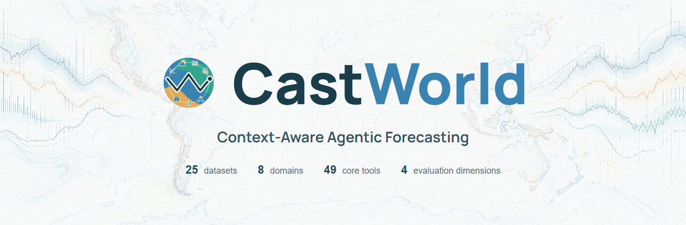
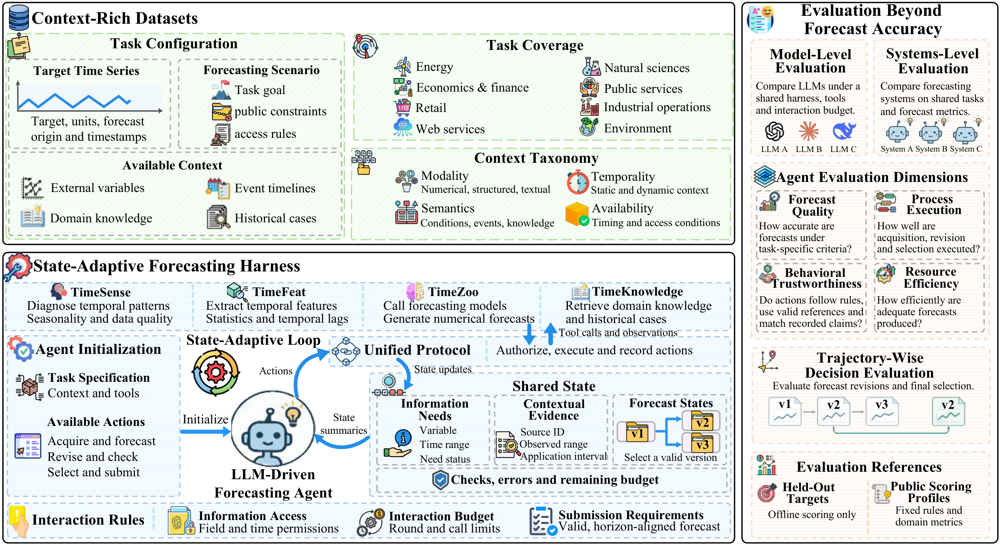

<h1 align="center">
  
</h1>

<p align="center"><a href="README.md"><kbd>English</kbd></a> · <strong>简体中文</strong></p>

<p align="center"><strong>超越预测精度：面向情境感知时间序列预测的智能体评测基准</strong></p>

<p align="center">
  <a href="https://castworld-bench.github.io/"><kbd>项目主页</kbd></a>
  <a href="https://arxiv.org/abs/2611.15262"><kbd>论文（arXiv）</kbd></a>
  <a href="#leaderboards"><kbd>排行榜</kbd></a>
  <a href="docs/GETTING_STARTED.md"><kbd>使用文档</kbd></a>
</p>

CastWorld 评测由大语言模型（LLM）驱动的智能体如何在同一预测环境中获取情境证据、生成和修订数值预测，并选定最终提交的版本。基准由三部分组成：包含多种情境信息的数据集、轻量且模块化的状态自适应预测框架（harness），以及以决策为中心的评测方法。

CastWorld 以**模型级评测**为主：不同模型使用同一套预测框架，从**预测质量、过程执行、行为可信度和资源效率**四个维度接受评测。**系统级评测**则在相同任务上比较不同预测系统的预测精度。

<p align="center">
  <a href="docs/assets/overview.pdf"></a>
</p>

<a id="one-environment-three-connected-pieces"></a>
### 一个评测环境，三个组成部分 

- **包含多种情境的预测任务。** 目标序列的历史观测、外生变量、事件、领域知识和历史案例均按统一的情境规范组织。
- **状态自适应的预测框架。** 框架分别记录信息获取、预测和执行三方面的状态，支持智能体收集证据、修订预测值、按公开规则检查预测并选定终稿，而不预设唯一的求解流程。
- **以决策为中心的评测。** 除了比较不同系统的预测精度，还从预测质量、过程执行、行为可信度和资源效率四个方面评估智能体的表现。

[项目主页](https://castworld-bench.github.io/) · [排行榜](#leaderboards) · [快速开始](#quick-start) · [数据集指南](docs/DATASETS.md) · [评测指南](docs/EXPERIMENTS.md)

<a id="leaderboards"></a>
## 排行榜 

论文报告了覆盖 1,310 个预测任务的评测，并在同一组 250 个任务上比较了 15 个大语言模型。目前维护的 A、B 榜采用单独划定的任务集。两榜均公开预测时可用的输入；A 榜同时公开预测时段内目标变量的真实值，B 榜的这部分真值仅由组织方持有，用于评分。

| 任务集 | 模型级 | 系统级 | 预测真值 |
| --- | --- | --- | --- |
| **A 榜 / 公开（300 个任务）** | [15 个模型，待评测](#a-model) | [24 种方法，待评测](#a-system) | 公开 |
| **B 榜 / 隐藏（100 个任务）** | [15 个模型，待评测](#b-model) | [24 种方法，待评测](#b-system) | 仅由组织方持有 |

**A、B 两榜均覆盖 25 个数据集：CastWorld-A 包含 300 个预测任务，CastWorld-B 包含 100 个。** 在[项目主页](https://castworld-bench.github.io/#leaderboards)先选择 A 榜或 B 榜，再选择模型级（Model）或系统级（System）。四张榜单均待独立评测。表格中的短横线表示尚无结果，不代表得分为零；导出为 CSV 时，相应单元格保留为空。主页页首可切换中英文，并会记住语言偏好。

<a id="a-model"></a>
<details>
<summary><strong>A 榜 / 公开（300 个任务）：模型级</strong></summary>

待评测。模型级评测在同一套预测框架下比较 15 个大语言模型，报告四个维度的得分及总分（TotalScore）。

<!-- BEGIN A_MODEL_TABLE -->
| 排名 | 模型 | 总分 | 预测分 | 过程分 | 可信分 | 效率分 |
| --- | --- | --- | --- | --- | --- | --- |
| - | GPT-6 Astra | - | - | - | - | - |
| - | GPT-6.1 Sol | - | - | - | - | - |
| - | DeepSeek-V4-Flash | - | - | - | - | - |
| - | Kimi K2.6 | - | - | - | - | - |
| - | Gemini 3.8 Flash | - | - | - | - | - |
| - | Grok4.7 | - | - | - | - | - |
| - | Claude Opus 5.5 | - | - | - | - | - |
| - | Qwen3.8-flash | - | - | - | - | - |
| - | GLM-5.3-flash | - | - | - | - | - |
| - | Claude Sonnet 5.5 | - | - | - | - | - |
| - | Qwen3.5-27B | - | - | - | - | - |
| - | GPT-6 Luna | - | - | - | - | - |
| - | Qwen3.5-4B | - | - | - | - | - |
| - | Qwen3.5-122B-A10B | - | - | - | - | - |
| - | Qwen3.5-9B | - | - | - | - | - |
<!-- END A_MODEL_TABLE -->

</details>

<a id="a-system"></a>
<details>
<summary><strong>A 榜 / 公开（300 个任务）：系统级</strong></summary>

待评测。系统级评测比较 24 种预测方法，报告 MASE、RMSSE 和平均排名。

<!-- BEGIN A_SYSTEM_TABLE -->
| 方法 | MASE | RMSSE | 平均排名 |
| --- | --- | --- | --- |
| ARIMAX | - | - | - |
| DLinear | - | - | - |
| PatchTST | - | - | - |
| iTransformer | - | - | - |
| TimeXer | - | - | - |
| TimesFM | - | - | - |
| Moirai | - | - | - |
| Sundial | - | - | - |
| Chronos | - | - | - |
| PromptCast | - | - | - |
| Time-LLM | - | - | - |
| TokenCast | - | - | - |
| LLMTime | - | - | - |
| TimeReasoner | - | - | - |
| Time-R1 | - | - | - |
| MemCast | - | - | - |
| AlphaCast | - | - | - |
| TimeCopilot | - | - | - |
| TimeSeriesScientist | - | - | - |
| Cast-R1 | - | - | - |
| CastFlow | - | - | - |
| MoiraiAgent | - | - | - |
| CastFSR | - | - | - |
| CastWorld | - | - | - |
<!-- END A_SYSTEM_TABLE -->

</details>

<a id="b-model"></a>
<details>
<summary><strong>B 榜 / 隐藏（100 个任务）：模型级</strong></summary>

待评测。模型级评测在同一套预测框架下比较 15 个大语言模型，报告四个维度的得分及总分（TotalScore）。

<!-- BEGIN B_MODEL_TABLE -->
| 排名 | 模型 | 总分 | 预测分 | 过程分 | 可信分 | 效率分 |
| --- | --- | --- | --- | --- | --- | --- |
| - | GPT-6 Astra | - | - | - | - | - |
| - | GPT-6.1 Sol | - | - | - | - | - |
| - | DeepSeek-V4-Flash | - | - | - | - | - |
| - | Kimi K2.6 | - | - | - | - | - |
| - | Gemini 3.8 Flash | - | - | - | - | - |
| - | Grok4.7 | - | - | - | - | - |
| - | Claude Opus 5.5 | - | - | - | - | - |
| - | Qwen3.8-flash | - | - | - | - | - |
| - | GLM-5.3-flash | - | - | - | - | - |
| - | Claude Sonnet 5.5 | - | - | - | - | - |
| - | Qwen3.5-27B | - | - | - | - | - |
| - | GPT-6 Luna | - | - | - | - | - |
| - | Qwen3.5-4B | - | - | - | - | - |
| - | Qwen3.5-122B-A10B | - | - | - | - | - |
| - | Qwen3.5-9B | - | - | - | - | - |
<!-- END B_MODEL_TABLE -->

</details>

<a id="b-system"></a>
<details>
<summary><strong>B 榜 / 隐藏（100 个任务）：系统级</strong></summary>

待评测。系统级评测比较 24 种预测方法，报告 MASE、RMSSE 和平均排名。

<!-- BEGIN B_SYSTEM_TABLE -->
| 方法 | MASE | RMSSE | 平均排名 |
| --- | --- | --- | --- |
| ARIMAX | - | - | - |
| DLinear | - | - | - |
| PatchTST | - | - | - |
| iTransformer | - | - | - |
| TimeXer | - | - | - |
| TimesFM | - | - | - |
| Moirai | - | - | - |
| Sundial | - | - | - |
| Chronos | - | - | - |
| PromptCast | - | - | - |
| Time-LLM | - | - | - |
| TokenCast | - | - | - |
| LLMTime | - | - | - |
| TimeReasoner | - | - | - |
| Time-R1 | - | - | - |
| MemCast | - | - | - |
| AlphaCast | - | - | - |
| TimeCopilot | - | - | - |
| TimeSeriesScientist | - | - | - |
| Cast-R1 | - | - | - |
| CastFlow | - | - | - |
| MoiraiAgent | - | - | - |
| CastFSR | - | - | - |
| CastWorld | - | - | - |
<!-- END B_SYSTEM_TABLE -->

</details>

各榜单的评测范围见[排行榜指南](docs/LEADERBOARDS.md)；A/B 榜单的托管和提交流程见 [Hugging Face 配置指南](docs/HUGGINGFACE.md)。

A/B 榜的数值数据沿用 GIFT-Eval 的 Hugging Face 数据集目录结构，配有兼容 GluonTS 的数据加载器。访问方式见 [A/B 数据使用说明](docs/AB_DATA.md)；配套的智能体任务包提供情境信息、知识和工具。

在同一榜内，模型级和系统级评测使用同一组任务：前者比较共享框架下的不同大语言模型，后者比较端到端的预测方法。

<a id="how-castworld-works"></a>
## CastWorld 如何运行 

[查看框架总览图（PDF）](docs/assets/overview.pdf)。

**数据集**为每个预测任务配备目标序列的历史观测和预测要求，并提供外生变量、事件时间线、领域知识与历史案例，明确规定各类信息的访问权限。情境规范从模态、时间属性、语义和可用性四个互补角度描述这些信息。

**状态自适应预测框架**允许取证与预测交替进行：中间预测可以引出新的信息需求，新获得的证据也可以促使智能体修订预测值。框架通过共享状态记录已获取的信息、已生成的预测版本、执行反馈和剩余预算。49 个核心工具支持检索、分析、预测构造和检查，另有面向特定领域的诊断工具。论文将这些能力分为四类：TimeSense 用于时序诊断，TimeFeat 用于特征提取，TimeZoo 用于调用预测模型，TimeKnowledge 用于获取领域知识和历史案例。各类能力对应的工具接口见[基准规范](docs/BENCHMARK.md#resources-and-operations)。

**以决策为中心的评测**将执行轨迹与每次保存后不再改写的预测版本关联起来，区分两类决策：如何修改预测值，以及最终选用哪个版本。评分在离线阶段进行，使用留出的目标真值和预先固定的评分配置。模型级评测比较同一框架下不同大语言模型的表现；系统级评测比较不同预测系统的预测精度。

八个应用领域分别为能源、自然科学、经济与金融、公共服务、零售、工业运营、网络服务和环境。[数据集与字段指南](docs/DATASETS.md)列出了全部 25 个数据集、字段含义、单位及发布版本中的访问权限。

<a id="quick-start"></a>
## 快速开始 

### 1. 安装与准备

下载并解压仓库 ZIP 文件，进入仓库根目录，使用 **Python 3.11 或 3.12**。如需调用原生预测工具现场推理，建议使用 Linux；跨平台 A/B 评测程序也支持 Windows。

```bash
python -m venv .venv
# Linux/macOS: source .venv/bin/activate
# Windows PowerShell: .venv\Scripts\Activate.ps1
python -m pip install -c requirements-reproduce.txt -e ".[test,data]"
python tools/reproduce.py prepare
python tools/reproduce.py audit --cohort A --no-cache
python tools/reproduce.py audit --cohort B --no-cache
```

`prepare` 会校验并解压随仓库提供的压缩包，不会下载数据或调用大语言模型。解压约需 3 GB 空间，运行环境和新增日志还需另留空间。无需 Git LFS，也不依赖服务器上已有的仓库副本。上述输入校验命令跳过了原生工具的候选预测检查。Chronos、TimesFM、Sundial 和 Moirai 共需 1,600 条候选预测，当前发布包解压后包含其中 500 条。因此，完整评测需要调用本地预测工具现场推理，或补齐与任务匹配的缓存条目。仅使用缓存时，程序会在发出任何大语言模型请求前，先检查所选任务需要的全部候选预测。

**在哪里找到全部 25 个数据集？** [release/assets](release/assets) 包含已发布的原始序列压缩包 `raw_<dataset>.zip` 和 A/B 任务包 `dataset_<dataset>.zip`。数据、预测框架和评测代码的位置见[发布文件索引](release/README.md)。

已发布的原始数据表还可以直接从 [raw_data/csv](raw_data/csv) 和 [raw_data/json](raw_data/json) 获取，每个数据集对应一个子目录。JSON 将每行存为一个数组，元素顺序与列名顺序一致；每个单元格都保留 CSV 中的原始文本，可无损还原表格内容；详见[格式与校验说明](raw_data/README.md)。两种格式的数据公开范围相同，均不包含 B 榜的预测真值。

### 2. 运行离线冒烟测试

```bash
python -m castbench.cli demo --out runs/offline_demo
python tools/test_release.py
```

演示使用合成输入和按脚本执行的智能体，输出执行轨迹以及旧版冒烟测试分数。该分数不代表 A/B 榜成绩。以上两条命令均不需要付费 API 调用，也不需要加载 GPU 模型权重。

### 3. 评测大语言模型

使用兼容 OpenAI **Chat Completions** 的接口，要求支持原生函数调用（框架提供的函数名为 `environment_action`），并返回 token 用量。若需更换接口、模型或调整容量限制及服务商选项，请将 `examples/portable_deepseek.json` 复制为本地配置文件，修改后通过 `--provider` 指定该文件。API 密钥应存入配置文件指定的环境变量。

下例使用本地模型实时推理。请先[配置四个本地预测模型](docs/REPRODUCTION.md#native-tools)，将 `/absolute/path/models.json` 换成实际的模型部署配置文件路径，并在 `--deployment` 中填写实际部署信息。

```bash
export CASTWORLD_API_KEY='YOUR_KEY'
# PowerShell: $env:CASTWORLD_API_KEY='YOUR_KEY'
python tools/reproduce.py run --cohort A --provider examples/portable_deepseek.json --out runs/deepseek_A --deployment "Describe actual host, service and concurrency" --workers 20 --active-requests 20 --rpm 12 --native-mode live --model-profiles /absolute/path/models.json --allow-api
python tools/reproduce.py score --out runs/deepseek_A
```

`--allow-api` 允许程序调用配置的服务生成预测，费用由服务商单独结算。若只评测 NYC-311 的全部任务，可添加 `--dataset NYC-311` 并使用单独的输出目录。使用 `--limit 1` 运行单任务启动检查时，也必须使用**独立的输出目录**；该结果不能作为完整任务集评分。运行 B 榜推理时，使用 `--cohort B` 并另设输出目录。B 榜推理不需要真值；只有组织方离线评分时，才需通过 `--labels-root` 指定单独保存的真值目录。框架不会将这些标签传给智能体。

断点续跑时，重新执行原样不变的 `run` 命令。只有在同一次评测因基础设施故障而中断时才加上 `--retry-failed`，以保留原有状态、预算和调用回执。已结束的任务（包括未能交付最终预测的任务）会保留，不会重跑。遇到意外的本地故障需先排查；更改配置、凭据或并发参数时，必须使用新的输出目录。只有所选数据集对应的任务全部结束后，才能运行 `score`。分步操作、输出文件和故障排查见[使用指南](docs/GETTING_STARTED.md)。

<a id="documentation-and-materials"></a>
## 文档与资源 

| 资源 | 内容 |
| --- | --- |
| [入门指南](docs/GETTING_STARTED.md) | 服务商配置、A/B 运行命令、评分、断点续跑与输出文件 |
| [基准规范](docs/BENCHMARK.md) | 全部 25 个数据集、访问权限、工具、交互协议与评分 |
| [数据集与字段指南](docs/DATASETS.md) | 数据集说明、各字段的可见范围及单位 |
| [发布文件索引](release/README.md) | 25 个数据集、可运行框架、评测代码及固定版本输入的位置 |
| [复现说明](docs/REPRODUCTION.md) | 固定版本的文件路径、完整性校验、缓存及原生工具现场推理 |
| [实验指南](docs/EXPERIMENTS.md) | 如何开展新评测、控制实验条件并管理本地输出 |
| [发布清单](release/manifest.json) | 压缩包及包内文件的哈希值、解压后生成的文件清单 |

运行时沿用内部包名 `castbench`，因此示例命令使用 `castbench.cli`。当前基准使用已固定版本的 25 个数据集。

无需调用模型，即可运行以下命令核对公开压缩包的内容范围、任务输入的标识和运行时文件：

```bash
python tools/verify_release_scope.py
python tools/export_raw_data.py check
```

公开版本包含数据集、任务定义、预测框架、评分代码及获准发布的原生工具候选预测。不随仓库发布的材料包括研究实验的运行输出、推理轨迹、人工评阅记录及实验结果导出文件。

<a id="reproduction-scope"></a>
## 复现范围 

可通过哈希值校验固定版本的任务输入、候选预测输出和评分定义。重新调用托管的大语言模型时，生成结果和耗时可能随服务商与部署方式而变化。已发表的结果与新生成的输出分开保存；各项诊断实验使用各自的任务子集和配置。

使用现场推理时，需另行获取原生模型权重并配置运行环境。请保留第三方声明，并遵守原数据和模型的使用条款；详见[复现说明](docs/REPRODUCTION.md)。已固定的原生候选预测是公开的工具资源；也可通过 `--native-mode live --model-profiles /path/to/models.json` 调用自行部署的本地模型，现场生成候选预测。
